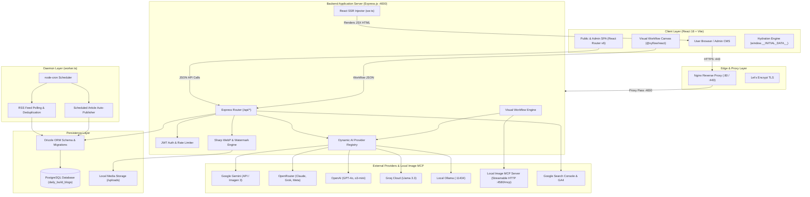
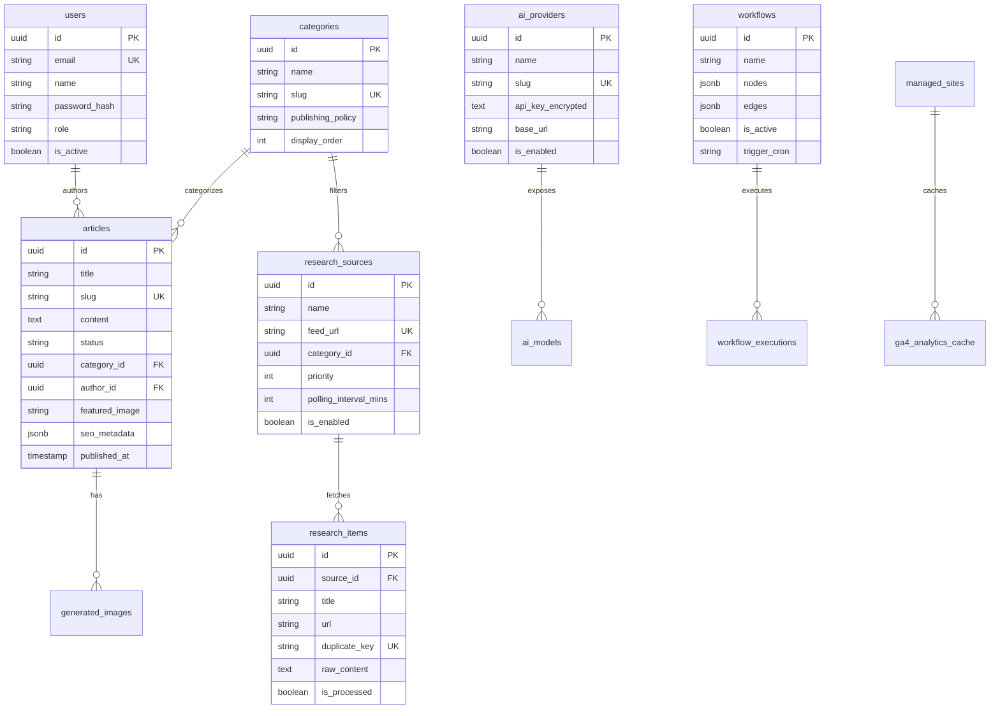

# System Architecture & Technical Specifications

This document outlines the architectural blueprint, data flow, component hierarchy, and design decisions of **Daily Build Blogs**.

---

## 1. High-Level Architecture Diagram



---

## 2. Subsystem Breakdown

### A. Frontend Layer (`client/`)
- **Framework:** React 18 with TypeScript and Vite 6.
- **Styling:** Tailwind CSS with dynamic dark/light mode context.
- **Public Website:** Highly responsive editorial interface with responsive typography, category archives, full-text search, reading progress bars, and social share actions.
- **Admin Panel (`/admin`):**
  - Lazy-loaded submodules to ensure the public bundle stays ultra-lightweight (<100 kB gzipped).
  - Visual Workflow Builder powered by `@xyflow/react` for drag-and-drop automation design.
  - Rich text article editing with Markdown support and real-time live preview.
  - Multi-site Google Search Console and GA4 analytics dashboard.
  - Dynamic AI model connection test and discovery manager.

### B. True React SSR Engine (`server/src/ssr.ts` & `client/src/entry-server.tsx`)
Unlike traditional SPAs that return empty HTML shells, Daily Build Blogs renders complete article and index HTML on the server:
1. When a crawler or user requests `/` or `/article/:slug`, `handleSsr` in `server/src/ssr.ts` executes.
2. It fetches the article data, author, category, and site settings directly from PostgreSQL using Drizzle ORM.
3. It passes the data into `entry-server.tsx` via `ReactDOMServer.renderToString`.
4. It dynamically synthesizes:
   - Optimized `<title>` and `<meta name="description">` (strict 58-character limit to avoid SERP truncation).
   - Complete OpenGraph tags (`og:title`, `og:image`, `og:description`, `og:type`).
   - Twitter Card meta tags.
   - Schema.org JSON-LD structured data (`NewsArticle`, `Organization`, `BreadcrumbList`).
   - Inlined hydration state: `<script>window.__INITIAL_DATA__ = {...}</script>`.
5. The client hydrates instantaneously without secondary fetch roundtrips or Cumulative Layout Shifts (CLS).

### C. Backend API & Business Logic (`server/src/`)
- **Runtime:** Node.js v20+ with ES Modules (`"type": "module"`).
- **Framework:** Express.js 4.x with `helmet`, `compression`, `cors`, and `cookie-parser`.
- **Database & ORM:** PostgreSQL accessed via `pg` connection pooling and Drizzle ORM for type-safe queries.
- **Security & Cryptography:**
  - Password hashing with bcrypt (10 rounds).
  - JWT-based authentication stored in HTTP-only cookies.
  - AES-256-GCM encryption for stored AI provider API keys.
  - Sanitization of user and feed HTML via `sanitize-html`.

### D. Dynamic AI Provider Architecture (`server/src/services/ai/`)
The platform implements a unified `AIProviderAdapter` interface:
```typescript
export interface AIProviderAdapter {
  slug: string;
  name: string;
  isAutomaticModel?: boolean;
  testConnection(apiKey?: string, baseUrl?: string): Promise<TestConnectionResult>;
  discoverModels(): Promise<DiscoveredModel[]>;
  generateText(options: GenerationOptions): Promise<GenerationResult>;
  generateImage?(prompt: string, model?: string): Promise<GenerationResult>;
}
```
Supported adapters:
1. **Google Gemini:** Official `@google/genai` SDK with text, structured JSON schemas, and Imagen 3 generation.
2. **OpenRouter:** Universal gateway accessing 300+ frontier and open-source models (Claude 3.7, Grok-2, DeepSeek, Llama 3).
3. **OpenAI:** Official OpenAI REST client for GPT-4o, GPT-4o-mini, and o3-mini.
4. **Groq Cloud:** Ultra-low latency inference for open models.
5. **Ollama:** Self-hosted open-source model execution.
6. **Google Antigravity CLI (`agy`):** Native CLI binary agent execution.
7. **OpenAI Codex CLI (`codex`):** Authenticated sandboxed code reasoning.
8. **Terminal GPT CLI (`tgpt`):** Keyless local CLI fallback.

### E. Visual Workflow Automation Engine (`server/src/services/automation/`)
- Workflows are defined as directed acyclic graphs (DAGs) composed of nodes and edges.
- **Node Types:**
  - **Triggers:** Cron schedule, Manual execution, RSS feed poll.
  - **Research:** Query feed, Deduplicate stories, Filter keywords.
  - **AI Generation:** Formulate outline, Write comprehensive article, Critique/Review, Generate 16:9 thumbnail, Generate SEO metadata.
  - **Publishing:** Save draft, Mark for review, Auto-publish.
- Each node produces structured outputs and execution logs recorded in the `workflow_executions` table.

### F. Image Processing & Watermark Pipeline (`server/src/services/image/`)
- All thumbnail generation passes through `featured-watermark.ts`.
- Uses high-performance **Sharp** (`libvips`).
- Composites the official DailyBuild watermark logo in the bottom-right corner with 72% opacity and 24px padding.
- Automatically normalizes aspect ratio to 16:9 and encodes into optimized WebP format at 85% quality.

### G. Local Image MCP Server (`local-image-mcp/`)
- A standalone Node.js Model Context Protocol (MCP) service running on the editor's machine or server.
- Listens on `http://localhost:4580` (or tunneled via ngrok) exposing `/mcp` via Streamable HTTP (SSE).
- Exposes tool `generate_and_upload_image` which orchestrates persistent browser automation with ChatGPT.
- Synthesizes 16:9 editorial imagery, uploads to ImgBB, and returns image metadata to the backend.
- The server backend ingests the cloud image, watermarks it with Sharp, and links it directly to the article.

---

## 3. Database Schema Overview


